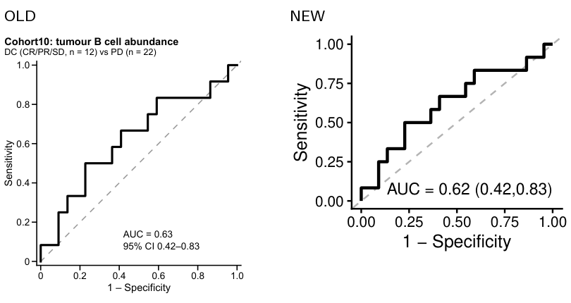
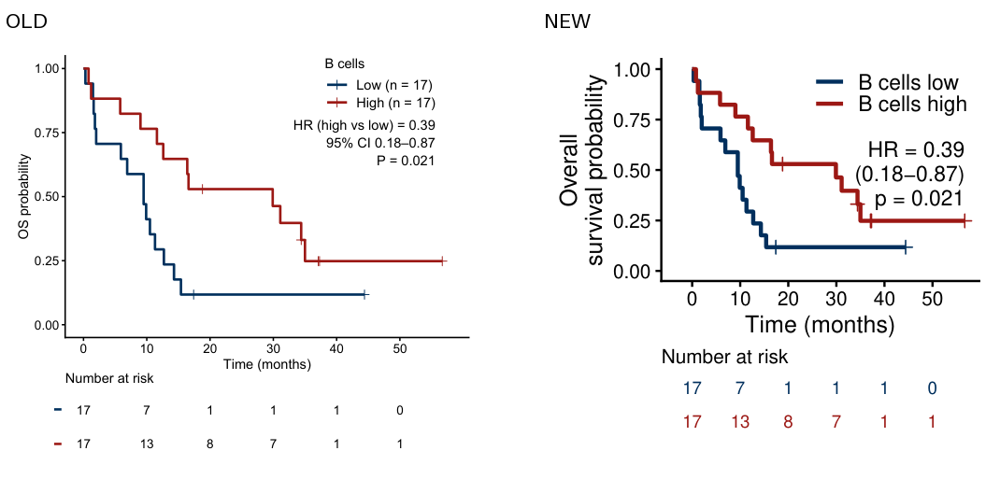
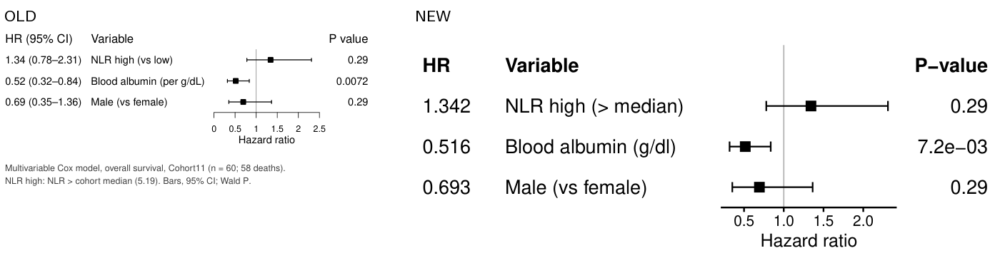
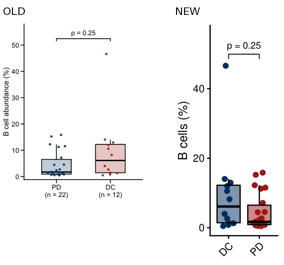
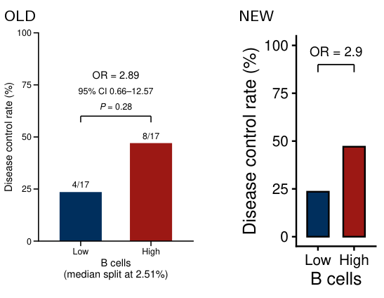
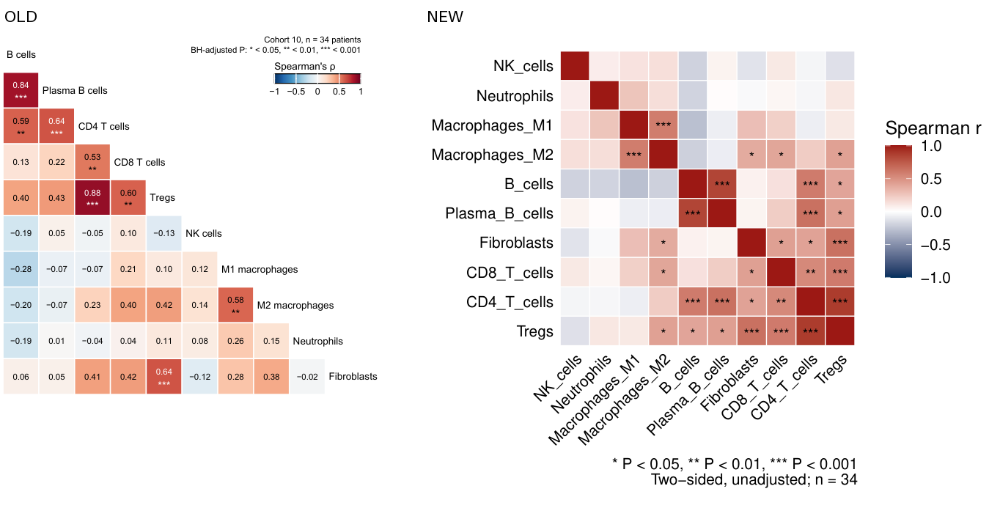

# 对比评测结果（第 1.7 步，2026-10-25）

6 个任务各用两种方式各跑一次（任务描述见 [tasks.md](tasks.md)）。每次运行都是一个全新的 agent，不知道本项目的开发过程。
原始记录：[run_log.json](run_log.json)（用时、工具调用、token、渲染次数、agent 自述的统计结果），
自动评分：`evals/score_runs.py`，参考答案：`evals/reference.R` → `reference.json`。

## 总表

| 任务 | 方式 | 用时 | 工具调用 | token | 渲染次数 | 代码行数 | 尺寸 (英寸) | 字号 (pt) | 统计结果 |
|---|---|---|---|---|---|---|---|---|---|
| ROC | 旧 | 338 s | 32 | 167k | 3 | 127 | 2.36 × 2.60 | 6–7 | AUC 0.625 (0.417–0.833) ✓ |
| | 新 | 48 s | 8 | 72k | 1 | 11 | 2.69 × 2.19 | 10–12 | 同上 ✓ |
| KM | 旧 | 560 s | 50 | 193k | 10 | 244 | 3.50 × 3.15 | 6.5–14 | HR 0.39 (0.18–0.87), p 0.021 ✓ |
| | 新 | 46 s | 8 | 73k | 1 | 10 | 3.29 × 3.00 | 9–12 | 同上 ✓ |
| 森林图 | 旧 | 475 s | 45 | 195k | 7 | 183 | 3.50 × 1.53 | 6–8 | 1.34 / 0.52 / 0.69 ✓ |
| | 新 | 46 s | 10 | 75k | 1 | 13 | 5.50 × 2.24 | 10–13 | 同上 ✓ |
| 箱线图 | 旧 | 259 s | 38 | 146k | 3 | 167 | 1.97 × 2.44 | 6.5–7 | Wilcoxon p 0.25 ✓ |
| | 新 | 60 s | 9 | 72k | 1 | 11 | 1.50 × 3.29 | 9–12 | 同上 ✓ |
| 比例柱状图 | 旧 | 352 s | 42 | 157k | 5 | 122 | 1.89 × 2.43 | 6–7 | 23.5% / 47.1%, OR 2.89 ✓ |
| | 新 | 57 s | 9 | 72k | 2 | 10 | 1.42 × 2.56 | 9–12 | 同上 ✓ |
| 相关热图 | 旧 | 460 s* | 55 | 196k | 6 | 145 | 3.50 × 3.39 | 5.5–7 | 8/45 显著（BH 校正）✓ |
| | 新 | 84 s | 12 | 82k | 3 | 9 | 5.25 × 4.35 | 9–12 | 15/45 显著（未校正）✓ |

\* 这次运行中途遇到用量上限，8.4 小时后接着跑完；用时是从运行记录里扣掉暂停后的实际工作时间。

## 平均值

| 指标 | 旧方式 | 新方式 | 倍数 |
|---|---|---|---|
| 用时 | 408 s（259–560） | 57 s（46–84） | 4.3–12.3 倍，平均约 7 倍 |
| 工具调用 | 43.7 | 9.3 | 4.7 倍 |
| token | 175.5k | 74.2k | 2.0–2.7 倍 |
| 渲染次数 | 5.7 | 1.5 | 3.8 倍 |
| 作图代码行数 | 165 | 11 | 15 倍 |

## 质量

- **统计结果**：12 次全部正确。唯一的差异是热图的显著性标准：旧方式用 BH 校正后的 p（与导师 HNSCC 代码一致，8 对显著），
  新方式用未校正的 p（15 对显著）。两者都对，但 45 次检验时 BH 校正更严谨。
- **导师风格（尺寸 + 字号）**：新方式 6/6 符合；旧方式尺寸 1/6、字号 0/6 符合。旧方式按 nature-figure 的规则做成
  期刊最终印刷尺寸（89 mm 栏宽、6–7 pt），这本身是合理的标准，只是不是导师的风格（2.3–3.3 英寸面板、12 pt）。
- **配色**：需要分组配色的 4 个任务里，两种方式都用了导师的深蓝 / 暗红。
- **自动检查**：最小字号检查 12/12 通过。文字碰撞检查旧方式 6/6 通过，新方式 5/6（热图未通过，见下）。
- **旧方式的额外开销**：每次运行都因为本机没有 XQuartz、`cairo_pdf` 无法使用而至少失败一次；KM 那次还因为
  nature-figure 自带的面板对齐脚本报错，自己写了一套测量代码。即使扣掉这些，旧方式仍慢 4 倍以上。

## 评测中发现并已修复的问题

1. **`labs()` 找不到**（新方式 6 次中有 2 次第一次渲染失败）：`library(labstyle)` 没有同时加载 ggplot2，
   而 SKILL.md 正是教 agent 写 `p + labs(...)`。已改为在 DESCRIPTION 的 Depends 里声明 ggplot2，并加了测试。
2. **热图碰撞检查误报**：检查脚本用"外接矩形"判断旋转文字，相邻的 45° 列标签字形并不相碰，却被判为重叠。
   旧方式的热图也撞上了同一个误报，花了一轮把标签改成水平。已把模板的列标签改为竖排（与导师 ComplexHeatmap
   的默认一致），修复后通过检查；并在 SKILL.md 里提醒 agent 遇到旋转标签的重叠报告先看图再改。

## 还没解决

- **AUC 柱状图**（45° 标签）同样会触发上面的误报。根本解决办法是让碰撞检查按单个字符的框判断旋转文字，
  需要改动从 nature-figure 拷来的检查脚本。
- **模板可以向旧方式学习的地方**（旧方式自己加上、确实更好的细节；2026-10-25 已全部加进模板，
  见 [style-spec 的增补表](../skill/lab-figure/references/style-spec.md)）：
  - 各组 n：ROC 副标题、KM 图例、箱线图 x 轴标签下、比例柱状图柱顶（4/17、8/17）
  - 森林图把 95% CI 印成文字列
  - 比例柱状图可选显示 OR 的 95% CI 和 Fisher p
  - 热图：默认 BH 校正、只画下三角、格子里印 r 值、变量名去下划线

## 局限

- 每个任务每种方式只跑了一次，数字只说明量级，不是严格的统计比较。
- 旧方式的 agent 按任务要求读了导师代码，但 nature-figure 的规则（期刊尺寸、字号）优先级更高，所以"导师风格"一项对旧方式不利；
  这正是最初"两套风格打架"的问题本身。

## 对照图

同一比例尺下的旧（左）/ 新（右）：

