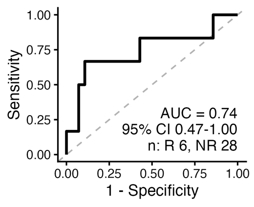
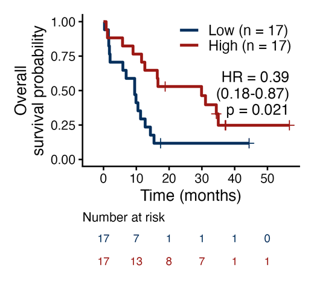
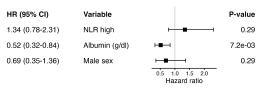
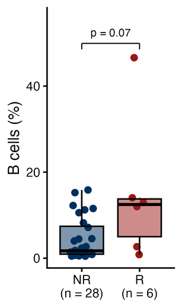
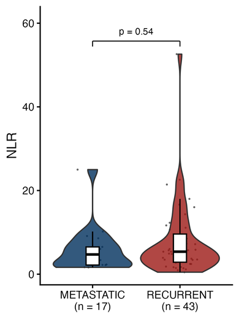
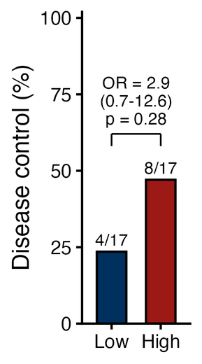
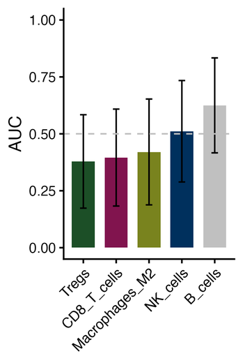
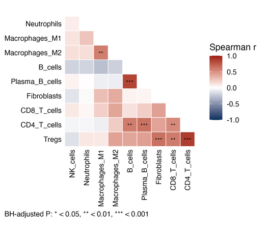
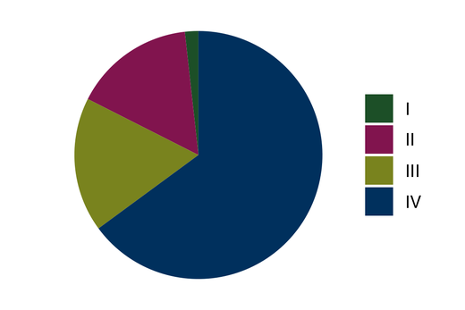

# Template catalog

Every template takes a data frame plus column names as strings, returns a plot
(ggplot or patchwork), stores its statistics in `lab_stats(p)`, and carries its
own size preset for `save_fig()`. Each thumbnail below is drawn from the
HNSCC example data by the matching script in the repo's `examples/` folder
(regenerate with `examples/make_gallery.py`).

Outcome handling (ROC, AUC, rate bar, KM event): 0/1 and TRUE/FALSE work as is;
1/2 status means 2 = event; text classes need `positive = "<event class>"`.

Group sizes are shown by default (ROC label, KM legend, box/violin axis, rate-bar
counts); every template that shows them takes `show_n = FALSE` / `show_counts = FALSE`
to turn them off.

## lab_roc — ROC curve with AUC (95% CI)

Use: how well a continuous score separates a binary outcome.
Needs: binary `outcome`, numeric `predictor` (one, or several for comparison).
```r
lab_roc(d, outcome = "response", predictor = "score", positive = "R")
lab_roc(d, "response", "score", positive = "R", youden = TRUE)        # mark best cutoff
lab_roc(d, "response", c("LORIS", "TMB", "PDL1"), positive = "R")    # coloured curves
```
Label (single curve): "AUC = 0.74 / 95% CI 0.47-1.00 / n: R 6, NR 28" in the lower right.
Options: `direction = ">"` if lower values mean positive; `labels =` legend names; `show_n`.
Stats: predictor, auc, lower, upper, n, n_pos, n_neg (+ youden_cutoff/sensitivity/specificity). Size: roc / roc_multi.

## lab_km — Kaplan-Meier with number-at-risk table

Use: survival (OS/PFS) by group, or by a score split at the median or a cutoff.
Needs: numeric `time`, `event` (0/1 or 1/2), and `group` or `score`.
```r
lab_km(d, time = "OS months", event = "OS status", score = "B_cells")              # median split
lab_km(d, "OS months", "OS status", score = "B_cells", cutoff = 5)
lab_km(d, "PFS months", "PFS status", group = "arm", levels = c("Control", "Drug"),
       ylab = "Progression-free\nsurvival probability")
```
Legend reads "Low (n = 17)"; the HR / CI / p label goes where the curves leave room.
Options: `xmax`, `break_by`, `labels`, `risk_table = FALSE`, `show_stats = FALSE`, `show_n`.
Stats: 2 groups → hr, lower, upper, p (Cox, first level = reference); more → log-rank p; n_by_group. Size: km.

## lab_cox_table + lab_forest — forest plot

Use: hazard ratios from a (multivariable) Cox model, or any estimate + CI table.
```r
tab <- lab_cox_table(d, "OS months", "OS status", terms = c("score_high", "Age", "Sex"))
lab_forest(tab)                       # columns: HR (95% CI) | Variable | interval | P-value
lab_forest(my_table, label = "dataset", estimate = "or", lower = "lo", upper = "hi",
           p = "p", est_name = "OR", xlab = "Odds ratio", log = TRUE)
```
Options: `ref` (default 1), `xlim`, `xbreaks`, `log`, `ci_text = FALSE` (3-decimal estimate only,
as in the original), `labels` (in lab_cox_table).
Stats: label, estimate, lower, upper, p. Size: 6.5 wide (5.5 with `ci_text = FALSE`), height grows with rows.

## lab_box — points + box, Wilcoxon p

Use: a numeric feature compared between groups.
```r
lab_box(d, x = "Response", y = "CD8_T_cells", levels = c("NR", "R"))
lab_box(d, "Stage", "score", comparisons = "all")                     # all pairs
lab_box(d, "group", "fraction", percent = TRUE, ylab = "% of CD8 T cells")
```
Axis labels carry the group sizes ("NR (n = 28)"); short names stay upright, long names tilt 45°.
Options: `comparisons` (NULL = the single pair, "all", "none", list of pairs), `test = "t"`, `ylim`,
`x_angle`, `show_n`.
Stats: group1, group2, n1, n2, test, p. Size: 0.75 + 0.6 in per group (narrow 1.5 in with `show_n = FALSE`).

## lab_violin — violin + inner box + points

Use: like lab_box for larger n or score distributions (single-cell scores).
```r
lab_violin(d, x = "EGR1_status", y = "Hypoxia_UCell")
```
Options as lab_box, plus `points = FALSE`, `trim`. Size: violin.

## lab_rate_bar — event rate per group with OR

Use: response / adverse-event rate (%) in Low vs High groups.
```r
lab_rate_bar(d, group = "score_group", outcome = "severe_irAE", levels = c("Low", "High"),
             ylab = "Severe irAE (%)")
```
Shows events/n on each bar and, for two groups, "OR = 2.9 / (0.7-12.6) / p = 0.28":
OR as in the original, Wald 95% CI, Fisher's exact p.
Options: `positive`, `show_counts`, `show_ci`, `show_p` (all TRUE by default).
Stats: group, n, events, rate, or, or_lower, or_upper, fisher_p. Size: bar2.

## lab_auc_table + lab_auc_bar — AUC comparison

Use: compare several predictors' AUC, optionally across datasets.
```r
tab <- lab_auc_table(d, outcome = "response", predictors = c("LORIS", "TMB"), positive = "R")
lab_auc_bar(tab)                                         # bars + CI, ordered by AUC
tab2 <- lab_auc_table(d, "response", c("LORIS", "TMB"), positive = "R", by = "cohort")
lab_auc_bar(tab2, dataset = "dataset")                   # mean bar + 1 SE + one dot per dataset
```
Stats: per-bar AUC table (or mean AUC per predictor). Size: grows with bar count.

## lab_cor_heatmap — correlation matrix with stars

Use: correlations among features, or features (rows) vs features (columns).
```r
lab_cor_heatmap(d, vars = c("B_cells", "CD8_T_cells", "Tregs", "NK_cells"))
lab_cor_heatmap(d, vars = cell_cols, vars_y = c("Age", "NLR"), method = "pearson")
```
Defaults: lower triangle, stars from Benjamini-Hochberg adjusted p (each pair counted once),
a caption explaining the stars.
Options: `p_adjust` (any `p.adjust()` method, or "none"), `triangle = "full"`, `cluster = FALSE`,
`show_values = TRUE` (r with stars under it), `note = FALSE`.
Stats: row, col, r, p, p_adj (one row per pair). Size: grows with matrix.

## lab_pie — composition

```r
lab_pie(d, category = "cancer_type")            # counts rows
lab_pie(summary_df, category = "type", count = "n")
```
Stats: category, count. Size: pie.
